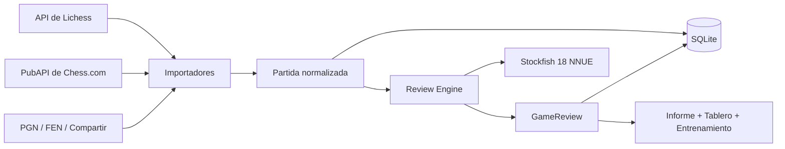

# Arquitectura técnica

## 1. Decisión de base

**Fork de [lichess-org/mobile](https://github.com/lichess-org/mobile), Flutter + GPLv3.**

Alternativas descartadas:

| Alternativa | Por qué no |
|---|---|
| Envolver `lichess.org/analysis` en un WebView | Depende de la web, no funciona offline, comparte cookies, la UI no es nativa, el motor se descarga en cada sesión y el mantenimiento es frágil. |
| Fork de `lila` (Scala) y usarlo como backend | Es un servidor completo; AGPL; montar infraestructura para un análisis que puede ser local es sobredimensionado. |
| App nativa Kotlin desde cero | Habría que reimplementar tablero, PGN, reglas, motor, i18n, accesibilidad y temas. Meses de trabajo antes de la primera función útil. |
| App Flutter desde cero | Igual que la anterior, pero al menos se reutiliza Dart. Aun así, se pierde el 60-70 % ya resuelto. |

La app de Lichess ya contiene:

- `dartchess`: reglas, PGN, variantes, posiciones.
- `chessground`: tablero, flechas, resaltados, temas.
- `multistockfish`: Stockfish 18 + NNUE en Android/iOS.
- Análisis interactivo, evaluación local y de servidor, explorador, tabla de finales.
- Importación de PGN y "aprende de tus errores".
- OAuth PKCE, cliente HTTP con reintentos y caché, i18n, notificaciones, deep links.

El trabajo nuevo se concentra en **importación multicuenta**, **revisión completa local** y **capa de entrenamiento/informe**.

## 2. Vista de alto nivel



La app no necesita backend propio para el MVP. El motor corre en el dispositivo; las APIs se llaman directamente desde el cliente con OAuth PKCE (sin secreto) y una cola serial.

## 3. Estructura de módulos propuesta

```text
lib/src/model/import/
  game_source.dart          # Interfaz y modelo normalizado
  lichess_source.dart       # Adaptador sobre el cliente existente
  chesscom_source.dart      # Cliente PubAPI + caché + cola serial
  pgn_source.dart           # PGN/FEN/compartir
  import_controller.dart    # Estado de la pantalla de importación

lib/src/model/review/
  review_game.dart          # Entrada normalizada
  move_review.dart          # Resultado por jugada
  game_review.dart          # Resultado completo
  move_tag.dart             # Etiquetas
  win_percent.dart          # cp/mate -> win% (reutiliza Eval)
  accuracy.dart             # Fórmulas de Lichess
  classifier.dart           # Reglas de clasificación
  review_engine.dart        # Orquestación del motor
  review_controller.dart    # Riverpod: progreso, cancelación, caché
  coach/
    coach_text.dart         # Plantillas en español
    tactical_facts.dart     # Material, jaques, capturas, amenazas

lib/src/view/import/
  import_hub_screen.dart
  lichess_import_screen.dart
  chesscom_import_screen.dart
  game_list_screen.dart

lib/src/view/review/
  review_screen.dart
  review_summary.dart
  review_graph.dart
  review_move_list.dart
  review_key_moments.dart
  review_player_card.dart
  training_screen.dart
```

La app usa Riverpod y `freezed`. Mantener ese estilo: modelos inmutables, controladores `AsyncNotifier`, providers por pantalla.

## 4. Modelo de datos

```dart
enum GameSourceType { lichess, chessCom, pgn, fen, share }

class ReviewGame {
  final String id;                 // id local estable
  final GameSourceType source;
  final String? sourceUrl;
  final String pgn;
  final Variant variant;
  final DateTime? playedAt;
  final String white;
  final String black;
  final int? whiteElo;
  final int? blackElo;
  final String? result;
  final String? timeControl;
  final String? opening;
  final String? eco;
}

enum MoveTag {
  book,
  forced,
  best,
  excellent,
  good,
  inaccuracy,
  mistake,
  blunder,
  great,
  brilliant,
  miss,
}

class MoveReview {
  final int ply;
  final Side side;
  final SanMove played;
  final Move? bestMove;
  final List<Move> alternatives;
  final int? evalBeforeCp;         // POV del que mueve, antes
  final int? evalAfterCp;          // POV del que mueve, después
  final int? mateBefore;
  final int? mateAfter;
  final double winPercentBefore;   // 0..100
  final double winPercentAfter;    // 0..100
  final double accuracy;           // 0..100
  final int centipawnLoss;
  final MoveTag tag;
  final String? coachText;
  final bool isKeyMoment;
}

class GameReview {
  final ReviewGame game;
  final double whiteAccuracy;
  final double blackAccuracy;
  final int whiteAcpl;
  final int blackAcpl;
  final List<MoveReview> moves;
  final List<MoveReview> keyMoments;
  final Map<MoveTag, int> whiteCounts;
  final Map<MoveTag, int> blackCounts;
  final ReviewSettings settings;
  final DateTime createdAt;
  final String engineVersion;
}
```

La partida se parsea con `dartchess` (`PgnGame.parseMultiGameLazy`) y se convierte al árbol de nodos de la app (`Root`, `Branch`) para reutilizar el tablero y el análisis existente.

## 5. Motor de revisión

### 5.1 Reutilizar, no duplicar

El motor ya está en:

- `lib/src/model/engine/engine.dart`: `SearchRequest`, `SearchLimit.depth`, `multiPv`, `threads`.
- `lib/src/model/engine/position_evaluator.dart`: evaluación por contexto.
- `lib/src/model/engine/engine_providers.dart`: un motor por `EngineSpec`, compartido.
- `lib/src/model/engine/engine_budget.dart`: reparto de hilos/hash.

`EvalWork` hoy usa `searchTime`; para la revisión conviene **añadir un `SearchLimit`** (depth o tiempo) o crear un `ReviewSearch` que use `SearchRequest` directamente. No duplicar el protocolo UCI.

El motor es compartido y `PositionEvaluator` aplica "last caller wins". La revisión debe:

1. Pausar la evaluación interactiva mientras corre el lote.
2. Serializar las peticiones (una posición a la vez).
3. Cancelar limpiamente y liberar el motor al salir.
4. No competir con una partida offline o un puzzle.

Para el MVP, la revisión corre mientras la pantalla está abierta. En la fase 4 se añade un servicio en primer plano para que siga con la pantalla apagada.

### 5.2 Estrategia de dos pasadas

**Pasada 1 — barrido rápido**

- Profundidad 14-16, MultiPV 1, 1 hilo.
- Evalúa la posición inicial y cada posición después de cada jugada.
- Calcula Win% y una primera clasificación.
- Detecta candidatas: caída de Win% > 5 puntos, mate perdido, única jugada, sacrificio.

**Pasada 2 — posiciones críticas**

- Profundidad 18-22, MultiPV 2-3, solo en candidatas.
- Obtiene mejor jugada, segunda mejor y línea principal.
- Decide "única", "estrella", "ocasión perdida" y el texto del entrenador.

Esto mantiene el coste cerca de una evaluación por jugada y evita MultiPV 3 en todo el árbol.

### 5.3 Convención de signos

Es la fuente de bugs más común:

- Cada evaluación se guarda desde el POV del jugador que mueve.
- La evaluación "después" se obtiene de la posición siguiente, donde mueve el rival: se niega antes de comparar.
- Los mates se mapean a ±1 en Win% (o a ±10000 cp para ACPL, con cap).
- El ACPL se calcula solo con la pérdida del que movió, cap ±1000 cp, y excluye jugadas forzadas y de libro.

### 5.4 Fórmulas

Win% (Lichess):

```text
win% = 50 + 50 * (2 / (1 + exp(-0.00368208 * cp)) - 1)
```

Accuracy por jugada (Lichess, con bonus de incertidumbre):

```text
accuracy = 103.1668100711649 * exp(-0.04354415386753951 * drop) - 3.166924740191411 + 1
accuracy = clamp(accuracy, 0, 100)
```

donde `drop` son puntos de Win% perdidos (0-100).

Accuracy de partida (Lichess `AccuracyPercent.gameAccuracy`):

1. Ventana deslizante de tamaño `clamp((plies - 1) / 10, 2, 8)`.
2. Desviación estándar de Win% en cada ventana.
3. Media ponderada por volatilidad.
4. Media armónica.
5. Promedio de ambas.

Se implementa con tests contra valores de referencia de Lichess.

### 5.5 Clasificación inicial

Los umbrales de Chess.com no son públicos; estos son propios y se calibrarán con usuarios. Se expresan en puntos de Win% (0-100).

| Etiqueta | Regla inicial |
|---|---|
| Libro | Posición dentro del libro de aperturas y primeras N jugadas |
| Forzada | Una sola jugada legal |
| Mejor | Es la mejor jugada del motor (o empate técnico) |
| Excelente | Caída ≤ 2 |
| Buena | Caída ≤ 5 |
| Imprecisión | Caída ≤ 10 |
| Error | Caída ≤ 20 |
| Error grave | Caída > 20 |
| Única | La segunda mejor opción cae ≥ 10 puntos y se jugó la mejor |
| Estrella | Sacrificio material ≥ 1 peón, se jugó la mejor/top-2 y la posición sigue ≥ 50 % |
| Ocasión perdida | Antes ≥ 70 %, después < 50 %, y existía una jugada que mantenía ≥ 70 % |

Reglas de contexto:

- Si antes y después se sigue ganando con claridad (Win% ≥ 80 en ambos), no etiquetar como error grave; como mucho "imprecisión".
- Si la posición ya estaba perdida, no inflar el error: usar la pérdida de Win% con cap.
- Las jugadas de libro no penalizan ACPL ni accuracy; se muestran como "Libro".
- "Estrella" es una heurística, no una verdad absoluta. La UI debe explicar por qué se dio.
- Las etiquetas y los umbrales son configurables por el usuario en ajustes avanzados.

### 5.6 Explicaciones del entrenador

Sin LLM en el MVP. Plantillas deterministas a partir de:

- Tipo de error (dejó una pieza, permitió mate, cambió la evaluación, etc.).
- Material antes/después.
- Jaques, capturas y amenazas inmediatas.
- La línea del motor (mejor jugada y respuesta esperada).
- La fase (apertura, medio juego, final).
- El tiempo restante, si el PGN lo trae.

Ejemplos:

> "Jugaste 23... Axf7+. El alfil quedó sin defensa y tu rival podía capturarlo con Txf7. La mejor era 23... Dd7, que mantenía la igualdad."

> "Tenías mate en 3 con 31... Th1+. En su lugar, 31... Dxa2 dejó escapar la victoria."

> "Jugada única: era la única que evitaba perder una pieza. La segunda mejor opción caía 2.4 peones."

Más adelante se puede añadir un LLM opcional para reformular, pero nunca para calcular la evaluación.

### 5.7 Rendimiento y batería

- 1 hilo por defecto en móviles; 2 en gama alta si el usuario lo activa.
- Cap de tiempo por posición (p. ej. 3 s) además de la profundidad, para posiciones patológicas.
- Pausa si la batería < 20 % o el dispositivo entra en ahorro extremo.
- Notificación de progreso y cancelación.
- Caché por `hash(PGN + motor + NNUE + depth + multiPv + versión de reglas)`.
- Reutilizar evaluaciones de la caché al abrir la misma partida o una transposición.

Presupuesto orientativo en gama media, 80 plies:

| Modo | Profundidad | Tiempo estimado |
|---|---|---|
| Rápida | 14 | 30-60 s |
| Equilibrada | 16-18 | 1-3 min |
| Profunda | 20-22 | 5-15 min |

Son estimaciones; se medirán en dispositivos reales antes de prometerlas.

## 6. Importación

### 6.1 Interfaz

```dart
abstract interface class GameSource {
  String get id;
  String get displayName;
  Future<List<LightGame>> listGames({required String username, int limit});
  Future<ReviewGame> fetchGame(String idOrUrl);
}
```

`LightGame` es una vista previa: jugadores, resultado, fecha, ritmo, URL, id. El PGN completo se descarga al abrir o al revisar.

### 6.2 Lichess

Reutilizar:

- `lib/src/model/game/game_repository.dart` (`getUserGames`, `getGame`).
- `lib/src/network/http.dart` y `aggregator.dart` (reintentos, NDJSON, límites).
- `lib/src/model/auth/auth_controller.dart` (OAuth PKCE).

Añadir:

- `getGameByUrl` para `lichess.org/{id}`.
- Lista con `max` configurable y filtros.
- PGN completo con `pgnInJson=true` o `Accept: application/x-chess-pgn`.

### 6.3 Chess.com

Cliente nuevo, aislado, con `http.Client` y una cola serial:

- `GET /pub/player/{username}`.
- `GET /pub/player/{username}/games/archives`.
- `GET /pub/player/{username}/games/{YYYY}/{MM}`.
- `User-Agent` identificable con contacto.
- `If-None-Match` / `If-Modified-Since` y caché de 12 h.
- Backoff ante 429; nunca peticiones en paralelo.
- Filtrar `rules == "chess"`; las variantes quedan para después.
- No hay endpoint público de "una partida por id"; para una URL, buscar en los archivos mensuales recientes por `url`/`uuid`, o pedir PGN.

Detalle completo en [IMPORTACION.md](IMPORTACION.md).

### 6.4 Normalización

- Parsear PGN con `dartchess`.
- Detectar variante, posición inicial, resultado y relojes.
- Si falta `[%eval]`, el motor local lo calcula.
- Si la partida es de Lichess y trae `[%eval]`, se puede usar como atajo, pero el informe local se recalcula para consistencia (o se marca como "análisis de servidor").
- Validar que la partida no esté vacía y que las jugadas sean legales.
- Guardar el PGN original para auditoría y el informe en JSON.

## 7. UI

### 7.1 Pantallas

1. **Importar**: pestañas Lichess / Chess.com / PGN.
2. **Lista de partidas**: filtros, fecha, resultado, ritmo; botón "Revisar".
3. **Revisión**: tablero, barra de evaluación, progreso, cancelar.
4. **Informe**: resumen, gráfico, movimientos, momentos clave.
5. **Entrenamiento**: posición, jugar, feedback, siguiente.

### 7.2 Componentes

- `EvalBar`: barra vertical u horizontal, animada, con mate.
- `AccuracyCard`: anillo o número grande, color por rango, sin copiar el diseño de Chess.com.
- `EvalGraph`: `fl_chart` o el `AcplChart` existente, con scrub y salto a jugada.
- `MoveBadge`: icono propio + etiqueta textual (no solo color).
- `KeyMomentCard`: jugada, evaluación, mejor alternativa, explicación.
- `BestMoveArrow`: reutilizar `chessground` arrows.
- `ReviewProgress`: porcentaje, jugadas analizadas, tiempo estimado.

### 7.3 Principios visuales

- Tema oscuro por defecto, con contraste AA.
- Acentos propios; no copiar la paleta de Chess.com.
- Iconos propios o de Material Symbols; no usar los glyphs de Chess.com.
- Nombres en español: "Revisión de partida", "Jugada estrella", "Ocasión perdida". Evitar "Game Review" y "Brilliant".
- Animaciones sutiles; nada que retrase la lectura.
- Modo claro y tamaño de texto dinámico.
- El tablero y las piezas existentes de Lichess se mantienen (son GPL y ya están integrados).

## 8. Persistencia

`sqflite` ya está en la app. Tablas propuestas:

```sql
imported_games(
  id TEXT PRIMARY KEY,
  source TEXT NOT NULL,
  source_url TEXT,
  pgn TEXT NOT NULL,
  played_at INTEGER,
  white TEXT, black TEXT,
  result TEXT,
  raw_json TEXT
);

reviews(
  id TEXT PRIMARY KEY,
  game_id TEXT NOT NULL,
  cache_key TEXT NOT NULL,
  report_json TEXT NOT NULL,
  created_at INTEGER NOT NULL
);

api_cache(
  url TEXT PRIMARY KEY,
  etag TEXT,
  last_modified TEXT,
  body TEXT,
  fetched_at INTEGER
);

mistakes(
  id TEXT PRIMARY KEY,
  game_id TEXT,
  ply INTEGER,
  fen TEXT NOT NULL,
  best_move TEXT,
  played_move TEXT,
  tag TEXT,
  due_at INTEGER,
  interval_days INTEGER,
  ease REAL
);
```

- `cache_key` incluye versión de la app, motor, NNUE, profundidad, MultiPV y versión de reglas.
- Limpiar caché antigua por LRU.
- Exportar/importar el cuaderno de errores en JSON (opcional).

## 9. Testing

- **Unitarios**: Win%, accuracy, clasificación, PGN, URLs, normalización, caché.
- **Con motor falso**: un `ReviewEngine` inyectable que devuelve evaluaciones fijas; los tests no dependen de Stockfish.
- **Widget**: pantallas de importación y de informe con datos de ejemplo.
- **Golden**: tarjetas y lista de movimientos en claro/oscuro.
- **Integración**: una partida real en Android con el motor; nightly, no en cada PR.
- **Contratos de API**: fixtures JSON grabados; nunca llamar a Lichess/Chess.com en CI.
- **Rendimiento**: medir 40 y 80 plies en gama baja/media/alta.

## 10. Entorno de desarrollo

La app actual requiere:

- Flutter 3.50.0 (según `pubspec.yaml`).
- Dart 3.14.
- Android `compileSdk 37`, `minSdk 26`.
- Java 17 para Gradle.
- Android SDK y un emulador o dispositivo.

Este repositorio ya se analiza y se prueba con Flutter 3.50 / Dart 3.14. Para compilar un APK hay que instalar además un JDK 17+ y el Android SDK. Ver `docs/product/PLAN.md`, fase 0.

CI recomendado:

```yaml
# .github/workflows/ci.yml (esquema)
- flutter pub get
- dart run build_runner build --delete-conflicting-outputs
- flutter analyze
- flutter test
- flutter build apk --debug
```

## 11. Dependencias nuevas

Idealmente, **ninguna**. La app ya trae:

- `http`, `dio`? (usar el cliente existente), `crypto`, `sqflite`, `fl_chart`, `flutter_appauth`, `share_plus`, `file_picker`, `deep_pick`.
- `multistockfish`, `dartchess`, `chessground`.

Si hace falta algo, evaluar licencia GPLv3-compatible y tamaño. Evitar paquetes abandonados.

## 12. Fases de implementación técnica

1. **Spike de importación**: un script Dart que descarga 5 partidas de Chess.com y las imprime; valida User-Agent, caché y parseo.
2. **Spike de revisión**: motor + 10 posiciones + JSON; valida fórmulas.
3. **Integración**: módulos en la app, providers y navegación.
4. **UI**: informe y entrenamiento.
5. **Pulido**: caché, background, tests, accesibilidad.

Cada fase debe terminar con tests y una demo ejecutable, no solo con código.
